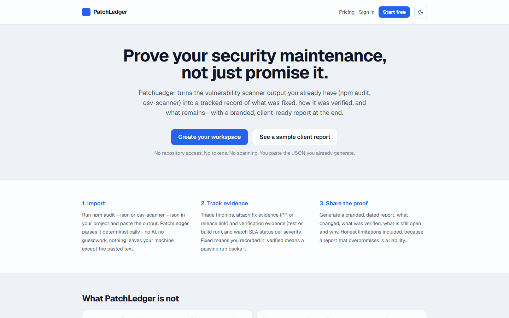
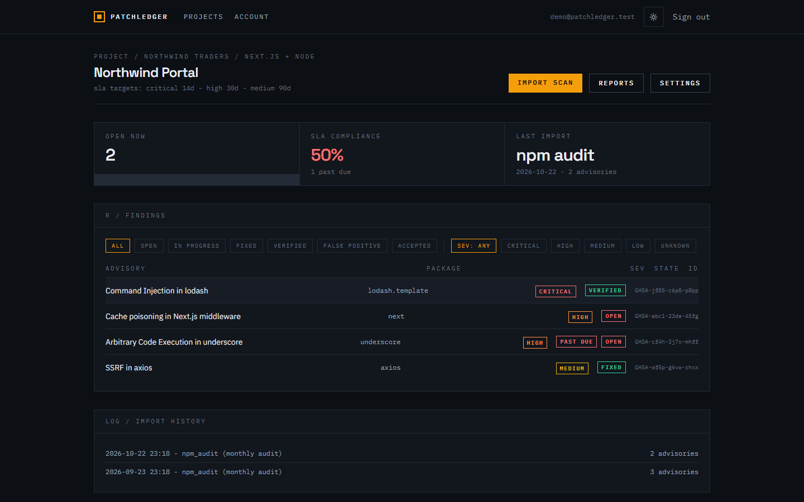
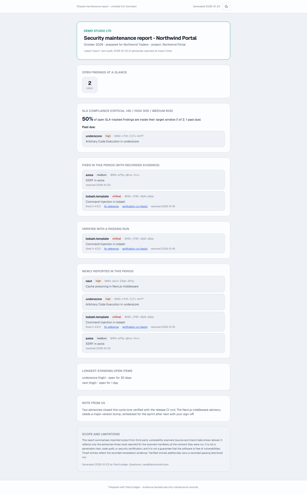
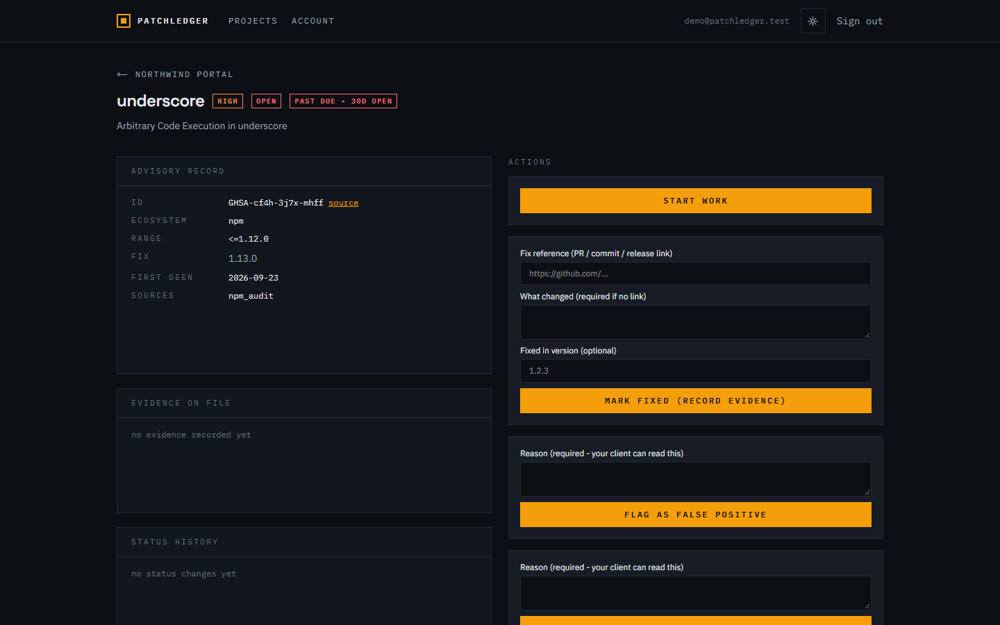
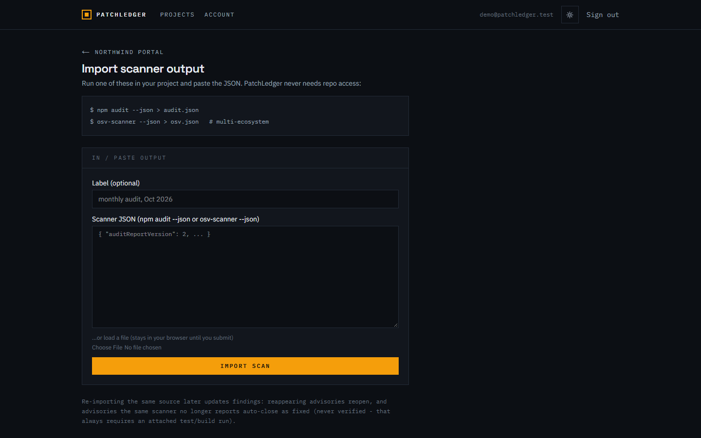

# PatchLedger

Evidence-backed security maintenance records for client projects. Import the vulnerability scanner output you already produce, track every advisory with fix and verification evidence, and share a branded client report that says exactly what was done - and what it does not prove.

[](https://patchledger.vercel.app)
[](https://github.com/devtechedge/patchledger/actions/workflows/ci.yml)


## Live Demo

https://patchledger.vercel.app

> Live production deploy on Vercel with a persistent Neon Postgres database and a seeded demo workspace. A sample client report generated from two imported npm audit snapshots is public: [sample report](https://patchledger.vercel.app/r/ffcbff31732032a6c1e5830c42ad4d9c). Demo login: `demo@patchledger.test` / `demo-password-1`. Billing is disabled during the pilot, so no payment surface exists.

## Screenshots

| Landing | Findings and SLA | Client report |
| --- | --- | --- |
|  |  |  |

| Finding evidence | Import |
| --- | --- |
|  |  |

## What it does

- Import `npm audit --json` or `osv-scanner --json` output by pasting it. No repository access, no tokens, no scanning.
- Deterministic parsing and dedupe at advisory level (package + advisory id), with severity normalization and CVSS 3.1 vector scoring.
- Re-import logic: advisories that reappear reopen; advisories the same scanner no longer reports auto-close as fixed, labelled as automatic. Cross-source imports never auto-close anything.
- Evidence-gated workflow: marking fixed requires a PR/commit/release reference or a note; marking verified requires a verification type plus a passing test/build run link or note; false positives and accepted risks require a client-readable reason.
- Per-project remediation SLAs (critical/high/medium day targets) with breach flags and a compliance percentage.
- Frozen client reports: branded, dated, explicit limitations statement, unguessable noindex share link, instant revocation.
- Auth with scrypt-hashed passwords and database-backed sessions, tenant isolation on every query, rate limits, an audit trail, and full account deletion.

## What it is not

Not a scanner, not an audit, not a certification. It never implies a report proves security. Parsing, merging, SLA math and reporting are deterministic - there is no AI in the data path and no customer data is sent to any model or third-party API.

## Stack

| Layer | Choice |
| --- | --- |
| Framework | Next.js 16 (App Router, server actions) |
| Language | TypeScript (strict) |
| UI | React 19, Tailwind CSS 4 |
| Database | PostgreSQL (Neon) via Prisma 7 + adapter-pg |
| Tests | Vitest unit suite, Playwright smoke + write-path e2e |

## Quick start

```bash
npm install                 # also runs prisma generate
cp .env.example .env        # Neon Postgres URLs + SESSION_PEPPER
npm run db:push             # create the schema (unpooled URL for DDL)
npm run dev                 # http://localhost:3000
```

Optional: `npm run db:seed` seeds a demo workspace (`demo@patchledger.test` / `demo-password-1`) with two imports, recorded evidence, and a published sample report.

```bash
npm test          # pushes schema to the test DB, then runs vitest
npm run typecheck # tsc --noEmit
npm run lint      # eslint
npx playwright test  # browser smokes against a dev server
```

## Documentation

[PROJECT_BRIEF.md](docs/PROJECT_BRIEF.md) - what and why. [SECURITY.md](SECURITY.md) - threat model, data flow and retention. [IDEA_SCORECARD.md](docs/IDEA_SCORECARD.md) - the dated evidence behind the product decision.

## License

All rights reserved. This is a commercial product in validation; source is public for review, not for reuse. Licensing may change - open an issue if you need permission for something.
